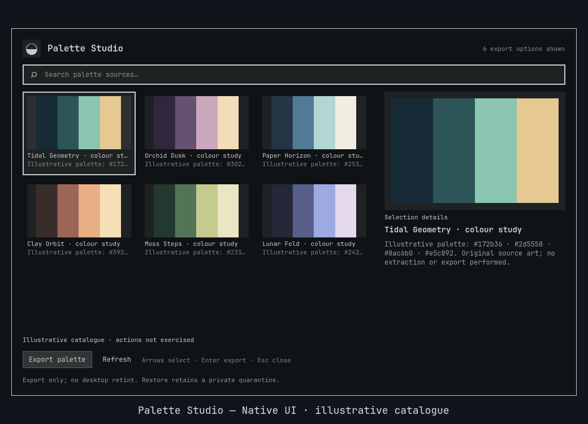

<div align="center">

# Palette Studio

**Take the colors with you. Leave the desktop alone.**

[](https://github.com/Battlelamb/omarchy-palette-studio/actions/workflows/ci.yml)

[Install](#install) · [Extract](#from-image-to-palette) · [Styles](#five-styles-one-local-source) · [Export](#export-and-recover) · [Configure](#configure-and-organize)

</div>

Turn a local wallpaper into a palette you can use elsewhere. Compare five styles, inspect numeric contrast, copy an individual hex color, or export JSON, CSS and GIMP palettes. No desktop retint, app-configuration rewrite or Wallbash template execution.

> [!IMPORTANT]
> **0.3.0 is a development/testing source snapshot, not a stable release.** It is installed for hands-on testing and has been opened on the maintainer's desktop. This is not live copy/export/Restore qualification or a passed full nested old/new/rollback gate.


*Historical 0.2.1 native Qt/Quickshell capture from an isolated headless compositor. Original color studies supply an illustrative catalogue; no extraction or export was performed. This image does not demonstrate 0.3.0 features or actions. [Preview provenance](docs/PREVIEW.md).*

## Install

Requires **Omarchy Quattro's native shell**, Python **3.11+**, the already-installed ImageMagick **`magick`** CLI for extraction, and **`wl-copy`** for clipboard copy. Missing tools are reported; nothing is installed automatically. No sibling plugin, Matugen, Aether or shared service is required.

```sh
omarchy plugin add https://github.com/Battlelamb/omarchy-palette-studio.git --enable
omarchy-shell shell summon leviathan.palette-studio
```

Review the source before enabling. Shell plugins execute as your user, not inside a security sandbox. This Git installation follows development source rather than a stable release tag.

<details>
<summary>Optional: Super+Space → Appearance → Palette Studio</summary>

Back up `~/.config/omarchy/extensions/omarchy-menu.jsonc`. Merge this entry into the existing menu object, or its `items` object if used. Preserve stock/personal entries; create the file only if it is absent.

```jsonc
{
  "appearance.palette-studio": {
    "label": "Palette Studio",
    "action": "omarchy-shell shell summon leviathan.palette-studio"
  }
}
```

The menu entry is optional and not added automatically. The summon command needs no dedicated hotkey.

</details>

## From image to palette

1. Open the panel and select a local image's **format-specific entry**. Each decoded image has JSON, CSS and GPL entries.
2. Open **Configure** to choose a style and maximum color count, then **Save settings**. Select the refreshed variant you want.
3. Inspect the resulting swatches and hex values. Click a swatch to copy it, or press **Enter / Export palette** to write the selected format.

| Control | What it does |
| --- | --- |
| Type to search | Filters the current catalogue. |
| Click a tile; arrows; Home / End | Selects a format-specific palette without exporting. |
| Click a color swatch | Copies that freshly revalidated hex color via `wl-copy`. Focused swatches also support Enter / Space. |
| **Enter / Export palette** | Exports only the selected JSON, CSS or GPL entry. |
| **More → Favorite** | Saves that format-specific selection as a favorite. |
| **Refresh** | Rereads local source images. |
| **Esc** / click outside | Leaves Configure first, or closes the panel. Existing exports remain. |

You can also copy through **More**: enter `{"index":0}` in **Optional action data (JSON object)**, then choose **copy color**. Indices start at zero. Only a selected extracted hex value is accepted, not arbitrary clipboard text or commands. Success confirms clipboard-helper acceptance, not a later paste into another app.

Wide layouts keep the image preview alongside the swatches; compact layouts use scrolling selection details.

## Five styles, one local source

Extraction samples frozen image bytes at **64 × 64**, composites transparency on black and quantizes to the requested maximum. Styles transform those actual sampled colors; a failed decode does not produce invented fallback colors.

| Style | Transformation |
| --- | --- |
| **Vibrant** (default) | Keeps sampled colors without an additional transform. |
| **Muted** | Caps HLS saturation at 0.35, preserving hue/lightness. |
| **Pastel** | Sets HLS lightness to 0.82; caps saturation at 0.55. |
| **Monochrome** | Removes saturation for neutral grays. |
| **High-contrast** | Alternates HLS lightness 0.08/0.92; caps saturation at 0.65. No contrast threshold is guaranteed. |

**Maximum colors: 2–16, default 6.** This is a ceiling, not a promise of that many distinct swatches. A flat image can yield one; style transforms can merge colors. This is not a full-resolution histogram, perceptual ranking or Material/Wallbash role generator.

### Contrast numbers, not certification

Details show the first swatch's contrast against black/white and the minimum pair ratio when multiple colors exist. The backend also returns all unordered color-pair ratios. These are numeric sRGB calculations on resulting hex values, **not accessibility certification**. Text size, transparency, actual UI context and monitor calibration are not assessed. The High-contrast name is a style, not a compliance guarantee.

## Export and recover

| Selected format | Written content |
| --- | --- |
| JSON | `schemaVersion` and a `colors` array. |
| CSS | `:root` custom properties named `--palette-1`, `--palette-2`, and so on. |
| GPL | A standard **GIMP palette**, not a license file. |

Exports go to identity-based filenames under:

```text
$HOME/.local/share/omarchy-palette-studio/exports/
```

There is no arbitrary destination or postprocessing command. Identical existing bytes are left alone; different bytes or symlinks are refused rather than overwritten. Source identity, style and color count distinguish variants. An ownership receipt preserves the previous Restore authority if a new export fails before publication.

**Restore detaches the last newly created, owned export from its public filename and retains its bytes in a hidden `.restore-*` file in the same exports directory. It does not delete the bytes.** Externally edited or replaced exports are refused. Other exports stay untouched; recovery can work without the original image, extractor or valid preferences.

Hidden recovery files are not automatically pruned, and there is no total export-storage quota. An editor that still holds the file open can continue modifying that inode after verification, including after Restore. Close writers and inspect retained files before manual recovery or cleanup. Restore is not a general filesystem undo.

## Configure and organize

Choose **Configure → Save settings** to persist changes.

| Setting | Default | Choices |
| --- | --- | --- |
| Palette style | Vibrant | Vibrant, muted, pastel, monochrome, high-contrast. |
| Maximum colors | 6 | Integer from 2 to 16. |
| Favorites only | Off | Restrict the backend catalogue to saved favorites. |

Favorites, Recent and named collections organize **format-specific** entries. Under **More**, enter a **Collection name** and use **Add/remove item**; **Delete collection** removes the grouping, not an export. Recent records confirmed copy/export operations only. Changing style/count requires a refreshed selection rather than silently reusing another variant's identity.

```text
$XDG_CONFIG_HOME/omarchy/lego/palette-studio/preferences.json
# Fallback when XDG_CONFIG_HOME is not absolute:
$HOME/.config/omarchy/lego/palette-studio/preferences.json
```

Preferences live outside the installed source. **Reset preferences** clears favorites, recent items, collections and options, returning to Vibrant / 6 colors. It does not remove exports or invalidate an owned Restore receipt. Recovery state lives under `$HOME/.local/state/omarchy-palette-studio/`.

### Local sources and limits

- Reads `~/Pictures/Wallpapers`, Omarchy user backgrounds and their immediate collection folders, installed-theme backgrounds and staged current-theme backgrounds. It does **not** inherit Wallpaper Browser's saved folders.
- Sources are bounded regular PNG/JPEG/WebP/BMP files, opened without following file/ancestor symlinks. Images are limited to **32 MiB**; membership to **512 files**. Catalogue extraction stops at **32 images / a five-second budget**.
- ImageMagick runs with fixed resource limits and an isolated HOME. Those guards are not certification against every malicious codec file. No image/font collection, extractor binary or user template is bundled.

<details>
<summary>Verification and troubleshooting</summary>

The recorded frozen 0.3.0 offline gate passed **68 Python tests**, with **1 explicit skip**, and **51 Node component tests**. Package and native component checks are separate overlapping coverage, not a live clipboard/export result. See [validation history](docs/VALIDATION.md), [CI scope](docs/CI.md) and the actual workflow status in the badge above.

The testing deployment was opened/captured/closed with real catalogue data. Live copy/export/Restore, long-soak behavior and the full nested upgrade/rollback gate remain unqualified. Earlier validation documents preserve their historical deployment status; no stable-release qualification follows from them.

From a checkout, set `TMPDIR` to an existing private scratch directory and run the shipped offline runner with its bwrap prerequisites:

```sh
env -u PYTHONPATH /usr/bin/python3 scripts/run-tests.py --backend-only
```

It clears HOME/environment, removes network/live sockets, exercises installed codecs and uses controlled clipboard fixtures.

| Symptom | Check |
| --- | --- |
| No extracted palettes | Check `magick`, supported safe roots, filters and the catalogue decode budget. Failures do not generate fallback swatches. |
| Copy failed | Check `wl-copy` and select a current source/style variant. CLI action indices must be valid zero-based integers. |
| Export/Restore is refused | Look for an existing different destination, edited export or replaced inode. Do not bypass ownership checks. |
| Success includes a preference warning | A later Recent-save or optional snapshot warning does not reverse accepted copy/export work. |

Unsafe or corrupt preferences are refused. New writes share an aggregate **128 KiB** budget; valid bounded legacy stores remain readable for explicit Reset/recovery. Individual list limits are not all usable at once. [Exact CLI, extraction and recovery contract](BACKEND.md).

</details>

<details>
<summary>Disable or remove</summary>

Use Restore first if you want the last owned export detached into recovery storage.

```sh
omarchy-shell shell hide leviathan.palette-studio
omarchy plugin disable leviathan.palette-studio
# Optional:
omarchy plugin remove leviathan.palette-studio
```

Removal does not clean up exported palettes, hidden recovery files or preferences.

</details>

---

**GPL-3.0-only** · [License](LICENSE) · [Source notices](NOTICE.md) · [Backend attribution](NOTICE.backend.md) · [Contributing](CONTRIBUTING.md) · [Security](SECURITY.md)

Independent community plugin by Ömer Eren. Not an official Omarchy or HyDE release.
