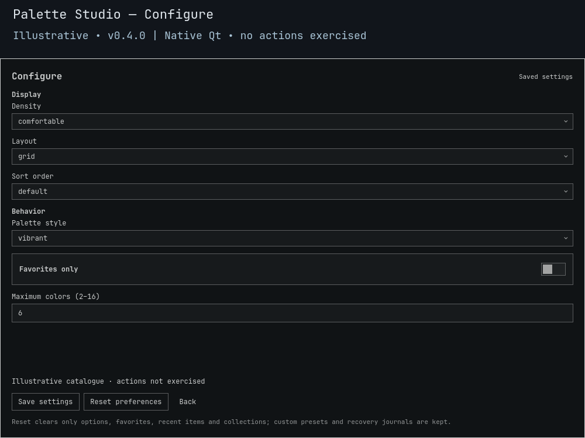

# Palette Studio

**Take the colors with you. Leave the desktop alone.**

Extract colors from local wallpapers, compare five styles and inspect numeric contrast. Copy one hex color, **Copy CSS palette** to the clipboard, or export JSON, CSS and GIMP palettes. No desktop retint, app-config rewrite or Wallbash template execution.

> **0.4.0 development candidate — not a stable release or installed upgrade.** Offline checks use real image fixtures and controlled clipboard helpers. Native UI integration, live clipboard/export/Restore and full nested upgrade/rollback need separate qualification.


*Illustrative **0.4.0** native Qt component render with fictional/original example data. No installed library, desktop action or full-shell behavior is demonstrated. [Preview provenance](docs/PREVIEW.md).*

<details>
<summary>Preview native saved settings</summary>



*Illustrative Configure view; fields may scroll. The capture does not exercise Save or Reset.*

</details>

## Install and open

Requires **Omarchy Quattro's native shell**, **Python 3.11+**, installed ImageMagick **`magick`** and **`wl-copy`**. Missing tools are reported, never installed automatically. No sibling plugin, Matugen, Aether or shared service is required. Shell plugins run as your user; review the source first.

```sh
omarchy plugin add https://github.com/Battlelamb/omarchy-palette-studio.git --enable
omarchy-shell shell summon leviathan.palette-studio
```

The Git install follows repository source, not an unreleased candidate or stable tag. Existing **Super+Space → Appearance → Palette Studio** entries continue to work; the summon command requires no dedicated hotkey.

## From image to palette

1. Select an image's **format-specific entry**: JSON, CSS or GPL.
2. Under **Configure**, choose the style/count and **Save settings**, then select the refreshed variant.
3. Inspect its swatches. Copy a color or the CSS palette, or explicitly export the selected format.

| Control | Result |
| --- | --- |
| Type; arrows; Home / End; click a tile | Search and select, without writing an export. |
| Click a swatch; Enter / Space on a focused swatch | Copy that freshly validated hex color. |
| **More → Copy CSS palette** | Copy all current styled colors as fixed CSS; no export or desktop change. |
| **Enter / Export palette** | Export only the selected JSON, CSS or GPL format. |
| **More → Favorite** | Save that format-specific selection as a favorite. |
| **Refresh** | Reread source images. |
| **Esc** / click outside | Leave Configure first or close; existing exports remain. |

Individual copy is also available under **More** using `{"index":0}` action data and **copy color**. Indices are zero-based. **Copy CSS takes no action data**, regardless of the selected row's format. It freshly extracts the selected source using current style/count, then sends this fixed shape to `wl-copy`:

```css
:root {
  --palette-1: #RRGGBB;
  --palette-2: #RRGGBB;
}
```

The names, indentation, semicolons and final newline are fixed; actual validated colors replace the placeholders. There is no caller prefix, template, arbitrary text, command or destination. Source/settings changes invalidate stale selections. Success confirms clipboard-helper acceptance, not a later paste; nothing reads the clipboard or records clipboard history.

## Five styles; contrast without certification

Extraction samples frozen image bytes at **64 × 64**, composites transparency on black and quantizes to **at most 2–16 colors** (default 6). Flat images or transformed duplicates can yield fewer colors, including one. Failed decoding never invents fallback swatches.

| Style | Transformation |
| --- | --- |
| Vibrant | Keep sampled colors; default. |
| Muted | Cap HLS saturation at 0.35. |
| Pastel | Set lightness to 0.82; cap saturation at 0.55. |
| Monochrome | Remove saturation. |
| High-contrast | Alternate lightness 0.08/0.92, saturation at most 0.65. No contrast threshold guaranteed. |

Numeric sRGB contrast shows first-swatch black/white ratios and the minimum pair ratio when available; structured results include every unordered pair. It is **not accessibility certification**, monitor calibration, a full-resolution histogram or a Material/Wallbash role generator. Text size, alpha and actual UI context are not assessed.

## Configure and organize

| Setting | Default | Choices |
| --- | --- | --- |
| Palette style | Vibrant | The five styles above. |
| Maximum colors | 6 | Integer 2–16. |
| Favorites only | Off | Saved favorites only. |
| Density | Comfortable | Comfortable or compact. |
| Layout | Grid | Grid or list. |
| Sort order | Default | Default, name, favorites-first; ties remain stable. |

Favorites, Recent and named collections organize **format-specific** selections. Under **More**, use **Collection name → Add/remove item** or **Delete collection**; deleting a grouping never deletes exports. Recent records confirmed copies/exports, not browsing.

Preferences survive source updates at `$XDG_CONFIG_HOME/omarchy/lego/palette-studio/preferences.json`, falling back to `$HOME/.config/omarchy/lego/palette-studio/preferences.json` when XDG is not absolute. **Reset preferences** clears favorites, recents, collections and options, not exports or Restore receipts. Unsafe/corrupt stores are refused. New saves share **128 KiB**; validated legacy reads remain bounded to **16 MiB**. A later preference warning does not reverse a confirmed copy/export.

## Export and recover

Exports go only to `$HOME/.local/share/omarchy-palette-studio/exports/<identity>.<format>`:

- **JSON:** `schemaVersion` and a `colors` array.
- **CSS:** the same fixed `:root` / `--palette-N` format used by Copy CSS.
- **GPL:** a GIMP palette, not a license file.

Identical existing bytes are untouched; different bytes or symlinks are refused, not overwritten. Copy CSS does not create an export or replace its Restore receipt.

**Restore detaches the last newly created owned export into a hidden `.restore-*` file in that directory. It retains the bytes, rather than deleting them.** Hash and inode checks refuse external edits/replacements. Other exports stay untouched, and recovery does not need the original image, extractor or valid preferences.

Held-FD editors can keep modifying the retained inode after verification. There is no automatic hidden-file pruning or total export quota: close writers and inspect files before manual recovery/cleanup. Closing, disabling or removing the plugin does not undo exports or clean up preferences/recovery data.

## Local-only limits and verification

- Scans `~/Pictures/Wallpapers`, Omarchy user backgrounds and immediate collections, installed-theme backgrounds and staged current-theme backgrounds. It does **not** inherit Wallpaper Browser's saved folders.
- Regular PNG/JPEG/WebP/BMP sources only: **32 MiB/image**, **512-file membership**; catalogue extraction at most **32 images / five seconds**. Selected actions revalidate the full bounded membership, not only previews.
- File/ancestor symlinks, special files and unsafe names are refused. Fixed ImageMagick resource limits/isolated HOME are not hostile-codec certification. No artwork, font library or user template is bundled.

Set `TMPDIR` to an existing private scratch directory and run from a checkout:

```sh
env -u PYTHONPATH /usr/bin/python3 scripts/run-tests.py --backend-only
```

The shipped offline bwrap runner clears HOME/environment, removes network/live sockets and uses controlled clipboard fixtures. It does not qualify live paste behavior or native pixels. [Validation history](docs/VALIDATION.md) covers earlier builds; [BACKEND.md](BACKEND.md) specifies exact CLI, extraction and ownership rules.

Empty palettes? Check `magick`, safe roots, filters and decode budgets. Failed copy? Check `wl-copy` and choose a fresh source/style variant. Refused Restore? Check external edits/replaced files; never bypass ownership checks.

```sh
omarchy-shell shell hide leviathan.palette-studio
omarchy plugin disable leviathan.palette-studio
# Optional; retains exports, hidden recovery files and preferences:
omarchy plugin remove leviathan.palette-studio
```

**GPL-3.0-only** · [License](LICENSE) · [Source notices](NOTICE.md) · [Backend attribution](NOTICE.backend.md) · [Contributing](CONTRIBUTING.md) · [Security](SECURITY.md)

Independent community plugin by Ömer Eren; not an official Omarchy or HyDE release.
